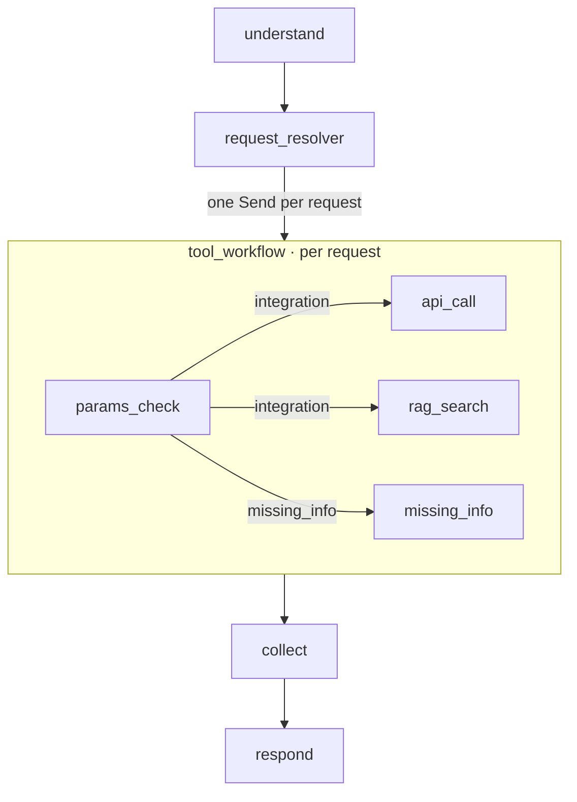

# Amazon Commerce Agent

A conversational shopping assistant built on **LangGraph**. It understands a user's
message, decides which tools to run (product search, product details, store‑policy Q&A),
executes them — in parallel when it can — and composes one grounded reply. Results are shown
as numbered cards the user can refer back to ("the second one", "the Sony one").

**Stack:** FastAPI · LangGraph · SQLAlchemy (async) · Postgres + pgvector · Redis + Celery ·
Haystack / PyMuPDF / tiktoken · OpenAI · SearchAPI.io — React 19 + Vite + Ant Design.

---

## Architecture

The agent is a graph. One user message flows through it like this:



- **understand** — turns the message into structured *requests* (tool + parameters), using
  conversation history, recent requests, and the currently visible result cards. Returns no
  request for a pure question/greeting.
- **request_resolver** — resolves each request: inherits a follow‑up's parameters, fills
  parameters from referenced cards, and asks for clarification when a reference is ambiguous.
- **tool_workflow** (a subgraph, run per request, up to `MAX_PARALLEL_TOOLS` at once) —
  `params_check` validates required parameters, then routes to:
  - **api_call** — REST integrations (Amazon product search / details via SearchAPI.io),
  - **rag_search** — retrieval over a knowledge base (store policies),
  - **missing_info** — asks the user for the missing parameters.
- **collect** — gathers outcomes, builds the numbered cards, and updates the entities the
  user can reference next turn.
- **respond** — composes one reply grounded in the outcomes. With no outcomes it uses a
  focused prompt that never fabricates product/store facts.

Every node streams **trace events** (and the prompts it sent) over a WebSocket for the UI's
Events/Reasoning panel, and the whole trace is persisted per interaction for debugging.

### Key designs

- **Entity references.** Results are shown as stable numbered cards. Understanding may only
  reference *visible* cards (the schema constrains it to the shown references); code then
  verifies the pick and fills the tool's id from it. The model does the fuzzy reading; code
  guards the facts.
- **Configuration‑driven tools.** Tools, parameters, integrations, entities and knowledge
  bases are declared in `app/configurations/`. A `validate_config()` runs at startup so a bad
  combination fails fast instead of mid‑conversation. Prompts stay domain‑general; the
  domain text (the agent's objective) lives in config and is injected.
- **RAG knowledge base.** Uploaded documents are chunked structure‑aware (Markdown headings,
  and PDF headings recovered from font size), embedded, and stored in pgvector. Indexing runs
  in a **Celery** worker; the document's status (`indexing → chunking → embedding → ready`,
  or `failed`/`retrying`) streams to the UI live over a WebSocket.
- **Deterministic where the LLM isn't reliable.** When a prompt‑only approach proved flaky
  (e.g. ranking a broad keyword by price surfaced cheap accessories), the fix was moved to
  config/code rather than more prompting — see *Design decisions* below.

---

## Project layout

```
backend/
  app/
    agent/            LangGraph graph, nodes, prompts, schemas
    configurations/   tools, parameters, integrations, entities, knowledge bases (+ validator)
    conversations/    threads, interactions, messages (router → service → repositories)
    knowledge_base/   upload API, chunking pipeline, indexing, retrieval
    traces/           per‑interaction trace persistence
    worker/           Celery app (background indexing)
    llm/              OpenAI client wrapper
    core/             settings
    database/         async engine, sessions, checkpointer
  migrations/         Alembic
  scripts/dev.sh      run the worker + API together
  evals/              LangSmith eval sets (understanding, references, …)
frontend/
  src/                React app (chat, cards, events/reasoning view, knowledge base page)
docker-compose.yml    Postgres (pgvector) + Redis
```

Everything goes through **router → service → repository**; nodes never touch the DB directly.

---

## Getting started

### Prerequisites
- Python ≥ 3.13 and [uv](https://docs.astral.sh/uv/)
- Node 18+
- Docker (for Postgres + Redis)
- API keys: OpenAI, and SearchAPI.io (for product search)

### 1. Infrastructure
```bash
docker compose up -d        # Postgres (pgvector) + Redis
```

### 2. Backend
```bash
cd backend
cp .env.example .env        # fill OPENAI_API_KEY and SEARCHAPI_API_KEY
uv sync                     # install dependencies
uv run alembic upgrade head # create tables
./scripts/dev.sh            # starts the Celery worker AND the API together
```
`scripts/dev.sh` runs the indexing worker in the background and the API on
`http://127.0.0.1:8000` (Ctrl‑C stops both). The worker is required for knowledge‑base
uploads to finish indexing; `/health` reports `indexing_worker: up/down`.

### 3. Frontend
```bash
cd frontend
npm install
npm run dev                 # Vite dev server, proxies the API + WebSockets
```

---

## Configuration

All settings live in `backend/.env` (see `.env.example` for the full annotated list). The
essentials:

| Variable | Purpose |
|---|---|
| `OPENAI_API_KEY` | Understanding (structured output) and the reply |
| `SEARCHAPI_API_KEY` | Amazon product search / details |
| `DATABASE_URL` | LangGraph checkpointer (psycopg) |
| `SQLALCHEMY_DATABASE_URL` | App data + Alembic (psycopg 3 driver) |
| `REDIS_URL` | Celery job queue + live document updates |
| `LLM_MODEL` | default `gpt-4.1-mini` |
| `LANGSMITH_API_KEY` | required to run the evals in `evals/` |

Context/token budgets and limits (history size, cards per reply, parallel tools, upload size)
are all tunable — see `.env.example`.

---

## Design decisions

- **Trust the LLM for reading, code for facts.** Entity references are the clearest example:
  the model picks from the visible cards, code validates and fills the id. The same instinct
  shows up in the respond guard (never state product facts without an outcome).
- **Keep prompts domain‑general.** The agent's objective text is config (`configurations/agent.py`)
  and injected into the prompts, so the prompts don't hard‑code "Amazon" or specific policies.
- **Product‑search sort was removed.** Sorting a broad keyword by price on the provider side
  returned irrelevant cheap accessories (a $3 "TV sticker" for "cheapest tv"). Prompt‑only
  attempts to detect and recover from this proved unreliable across many tests, so the fix
  was to **stop sending the sort to the API** (search by relevance) and document it, rather
  than add fragile rules. Relevance‑aware sorting over the results is a future option.
- **Background indexing with a real queue.** Uploads hand off to Celery (survives restarts,
  retries transient failures with backoff) instead of in‑process background tasks; progress
  streams to the UI over Redis pub/sub + WebSocket.
- **Grounding over explanation.** The agent never explains or guesses *why* results look a
  certain way, and never claims a product is unavailable from a single search page — it says
  what the results are and offers to search again.

### Why a custom chunker

We chose a custom chunker because we wanted more control over structure-aware chunking,
specifically:

1. **section_path** — نحافظ على تسلسل العناوين، مثل `Returns > Electronics > Warranty`.
2. **Merge small sections** — ندمج الأقسام الصغيرة المرتبطة ببعض، بدل ما نخزن Chunks صغيرة جدًا.
3. **PDF page ranges** — نحفظ `page_start` و`page_end` لكل Chunk حتى نعرف مصدر المعلومات.
4. **Custom splitting rules** — نتحكم بحدود الـTokens وطريقة تقسيم المستند.

---

## Evaluation

Eval sets live in `backend/evals/` and run against LangSmith (set `LANGSMITH_API_KEY`):

```bash
cd backend
uv run python -m evals.understanding.run
uv run python -m evals.references.run
```

They cover Understanding (message → requests) and entity‑reference resolution. A RAG eval
(recall@k, abstention) is planned.

---

## Known limitations

- **Product‑search relevance** is the provider's keyword match; broad terms can still return
  accessories. "Cheapest of relevant" isn't implemented (see *Design decisions*).
- **Meta‑questions** like "why am I not seeing TVs?" route inconsistently (no tool answers
  them) — handled by the grounding guard so they never hallucinate, but not by true intent
  understanding.
- **No auth** on the knowledge‑base upload/delete API — keep it local, not public.
- **Test coverage** is light (evals exist; unit/API tests are the next priority).
